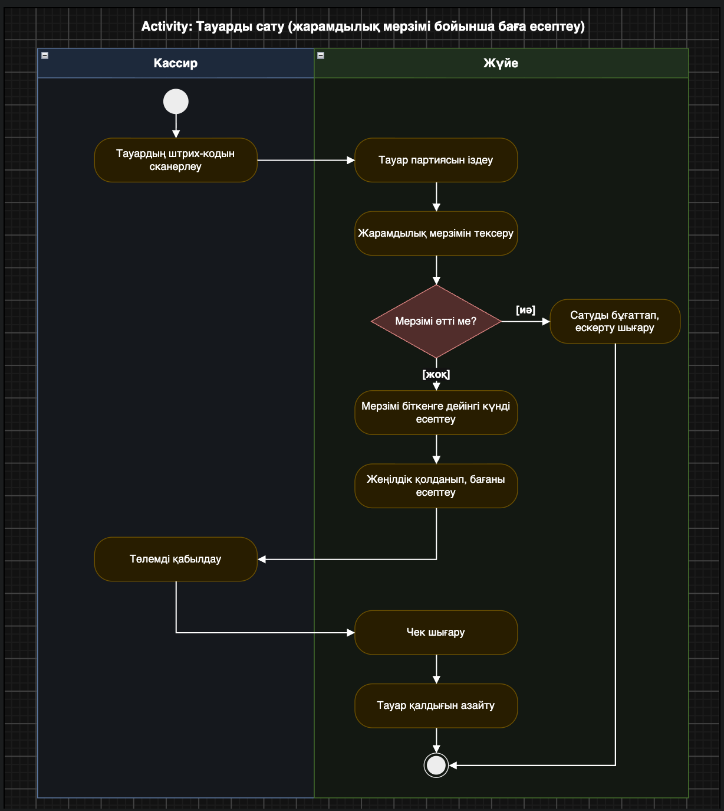

# Азық-түлік дүкендерінде жарамдылық мерзімі бойынша тауар бағасын есептеуді және сатуды автоматтандыруға арналған веб-қосымша

Автор: Нұрсұлтан Ілімбай, ВТК24-1б

## Мәселе
Дүкендерде мерзімі жақындаған тауардың бағасын қызметкерлер қолмен өзгертеді, сондықтан қате кетеді, ал тауар сатылмай қалып, ысырап болады. Кейде мерзімі өткен тауар кассадан өтіп кетеді. Бұл веб-қосымша әр партияның жарамдылық мерзімін бақылап, қалған күнге қарай жеңілдікті өзі есептейді және мерзімі өткен тауарды сатуға жол бермейді. Ол шағын және орта азық-түлік дүкендеріне арналған.

## Акторлар
- Кассир
- Дүкен менеджері

## Талаптар
### Функционалдық
1. Жүйе тауар партиясын жарамдылық мерзімімен бірге тіркеуі керек
2. Жүйе мерзімі біткенге дейінгі күнге қарай жеңілдікті автоматты есептеуі керек
3. Жүйе мерзімі өткен тауарды сатуға тыйым салуы керек
4. Жүйе сатудан кейін тауар қалдығын азайтуы керек
### Функционалдық емес
1. Бағаны есептеу 1 секундтан аспауы керек
2. Интерфейс қазақ және орыс тілдерінде болуы керек

## Диаграммалар
### 1. Use Case
_Кейін қосылады_
### 2. Class
_Кейін қосылады_
### 3. Activity: Тауарды сату (жарамдылық мерзімі бойынша баға есептеу)

### 4. Sequence: Тауарды сату (жарамдылық мерзімі бойынша баға есептеу)
_4-жұмыс: кейін қосылады_
